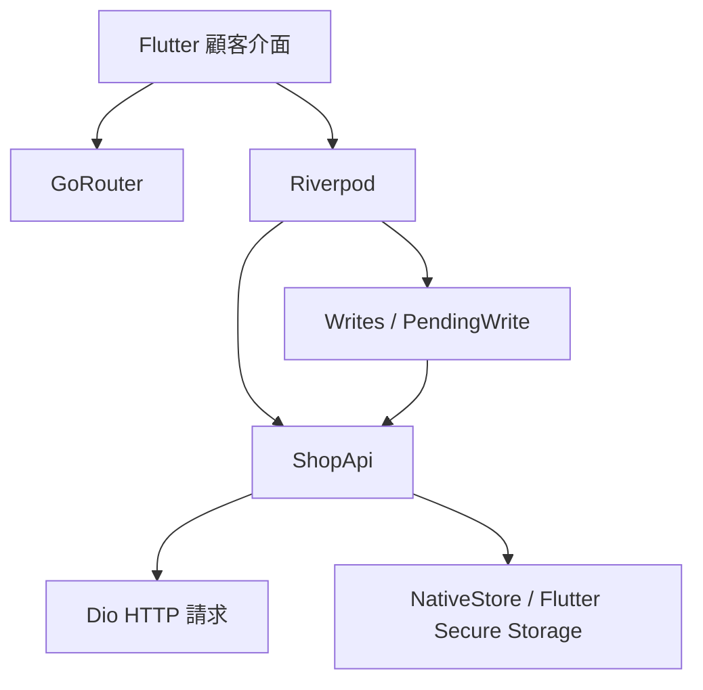

# Figura App

*A Flutter customer app for browsing and purchasing in-stock and preorder figures and collectibles.*

Figura（原 ELPSY Shop）是公仔與收藏品電商，本倉庫為獨立 Flutter 顧客 App。
提供收藏者從商品瀏覽、現貨與整筆預購結帳，到訂單及到貨進度查詢的行動購物流程。
App 與網站共用 [Figura API](https://github.com/jackteng-dev/figura-api)，顧客端只串接公開商品與行動會員 API。

## 展示

- **Android 測試版 APK**：[下載 Figura-sandbox.apk](https://github.com/jackteng-dev/figura-app/releases/latest/download/Figura-sandbox.apk)（[版本頁](https://github.com/jackteng-dev/figura-app/releases/latest)），連線公開沙盒 [figura.jackteng.dev](https://figura.jackteng.dev)。資料皆為虛構，每天 04:00（台北時間）自動重置。
  - 示範顧客：`demo_customer` / `figura-demo-customer`（也可自行註冊，請勿輸入真實個資）
  - 由 GitHub Actions 建置並以沙盒示範金鑰簽章，非商店版本；安裝時需允許安裝不明來源的應用程式。
- 同一套後端的網站版與員工後台也可在[線上沙盒](https://figura.jackteng.dev)體驗。

## 主要功能

- 會員註冊、登入、個人資料編輯與本裝置登出。
- 現貨商品、款式與主圖瀏覽；預購批次、名額、截止時間及預估到貨區間查詢。
- 購物車數量調整、商品移除，以及收件地址新增、編輯與刪除。
- 現貨與整筆預購結帳、後端報價核對、模擬付款成功／失敗。
- 本人訂單分頁查詢與取消；退款、退貨、預購分配及配送進度查詢。
- 連線中斷後的未確認操作提示、重啟恢復與核對流程。

## 技術架構

| 層 | 技術 |
| --- | --- |
| 行動介面 | Flutter 3.47.6、Dart 3.13.5、Material 3、繁體中文 |
| 狀態與導航 | Riverpod、GoRouter |
| API 與交易狀態 | Dio、ShopApi、Writes／PendingWrite、UUID |
| 原生安全儲存 | Flutter Secure Storage；Android Keystore／iOS Keychain |
| 驗證工具 | flutter_test、原生測試入口、瀏覽器測試 harness |



Dio 存取公開 `catalog` 與 Bearer 驗證的 `mobile/customer` 路由；正式 API 必須使用 HTTPS。App 不另建產品資料庫，後端業務規則由共用 API 負責。

## 工程重點

- **未知結果與冪等操作**：送出前安全保存顧客、原 UUID 與完整 body；結果未知時凍結新寫入，僅允許明確重試原 UUID 操作，程序重啟後仍能核對。見[寫入狀態實作](lib/core/api.dart)與[API 與安全](docs/API.md)。
- **版本衝突與一致性**：購物車、地址及訂單操作帶入版本；版本寫入回覆遺失後先讀取核對，不盲目重送。收到成功 ACK 即清除待確認狀態，後續讀取失敗只重讀。見[行為測試](test/api_test.dart)。
- **登入並行控制**：同時發生的 401 共用一次 refresh，原請求最多重試一次；以登入世代與憑證寫入佇列處理登出競爭，避免延遲回應恢復登入。見[Session 實作](lib/core/api.dart)與[回歸測試](test/api_test.dart)。
- **憑證與顧客隔離**：access token 只留記憶體，refresh、裝置識別與未完成操作存原生安全儲存；不同顧客不能接管他人的待確認操作。見[儲存實作](lib/core/storage.dart)與[安全規則](docs/API.md)。

## 品質與交付

- 依[交接文件](docs/HANDOFF.md)紀錄：format、analyze 通過，unit／widget 測試 13 項通過，另 1 項 live socket 測試預設略過；此為文件中的既有結果。
- 同份文件記錄 Android 模擬器原生核心驗收 4 階段、手動畫面與生命週期檢查 8 項通過；完整 UI 自動化仍未通過。
- 現有 GitHub Actions 為手動觸發的 [Android test APK](.github/workflows/android-test-apk.yml)：固定 Flutter 版本、format → analyze → test → debug APK，產生校驗碼與 artifact，並嘗試附加至既有私人草稿 Release。
- 本倉庫沒有名為 `verify` 的工作流程，也沒有 PR → CI → 私有 GHCR 映像 → 自架伺服器拉取式 CD 的設定；目前交付形式為 Android 測試 APK。

## 本機啟動

準備上述 Flutter SDK、Android SDK 與模擬器，先依後端文件啟動自己的全新隔離測試環境。
將 shell 環境變數 `API_BASE_URL` 設為該後端的完整 API 位址，路徑以 `/figura/api/` 結尾，再執行：

```sh
flutter pub get
flutter run --dart-define=API_BASE_URL="$API_BASE_URL"
```

API 無預設正式位址；release 僅接受 HTTPS，debug 的 HTTP 例外限本機回環與模擬器主機。裝置連線、驗收重跑與簽章步驟見[詳細設定](docs/DEVICE_ACCEPTANCE.md)。

## 已知限制

- 僅完成 Android 模擬器驗證；尚未驗證實體裝置、iOS build／Keychain 執行，也未完成商店上架或正式 API 連線。
- 付款、物流、退款與通知仍為 mock，沒有實際收款、寄送或推播；尚未作為正式營運服務。
- Android 正式簽章仍需商家憑證；未提供簽章設定時，release 建置產物為 unsigned，不能直接安裝或上架。
- 瀏覽器 harness 僅供測試，使用記憶體儲存，不是正式 Web 登入入口。
- 預購目前支援整筆結帳；訂金尾款、延期與部分退款尚未實作。

## 文件

- [目前交接與驗證結果](docs/HANDOFF.md)
- [API、安全與操作恢復規則](docs/API.md)
- [Android 安裝、驗收與 iOS 建置步驟](docs/DEVICE_ACCEPTANCE.md)
- [實體裝置與正式環境待驗項目](docs/CLOUD_LOCAL_FOLLOWUP.md)
- [繁中字型來源與授權](assets/fonts/README.md)
- [原 README 開發紀錄](docs/DEV_LOG.md)
